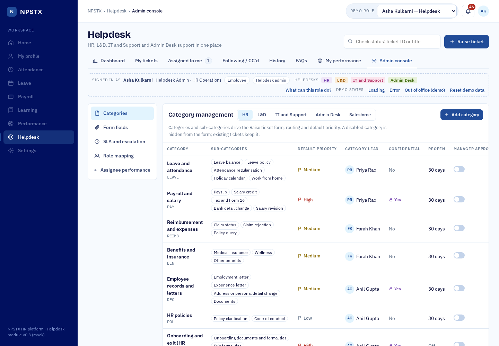
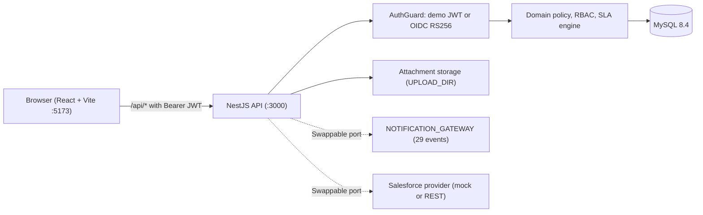

# NPSTX Integrated Helpdesk

[](https://github.com/sprabudh/npstx-helpdesk-app/actions/workflows/ci.yml)


An enterprise, multi-department Helpdesk module for the **NPSTX workspace**. It unifies internal support across **HR**, **L&D**, **IT and Support**, **Admin Desk**, and **Salesforce** into one governed ticketing experience.

Employees raise and track requests in one place. Agents, leads, and approvers work governed queues and approval gates. Admins configure all five helpdesks. The module is designed to plug into NPSTX Common/RBAC, SSO/OIDC, the central Notification Module, and Salesforce through explicit adapter boundaries.

> The screenshots in this README were captured from the current NPSTX-branded UI.

## Table of Contents

- [Objective](#objective)
- [Key Features](#key-features)
- [Current UI](#current-ui)
- [Tech Stack & Architecture](#tech-stack--architecture)
- [Repository Structure](#repository-structure)
- [Prerequisites](#prerequisites)
- [Quick Start: Hybrid Local Development](#quick-start-hybrid-local-development)
- [Running Fully in Docker](#running-fully-in-docker)
- [Environment Configuration](#environment-configuration)
- [Command Reference & Testing](#command-reference--testing)
- [Roles & Access Matrix](#roles--access-matrix)
- [Platform Integration Guide](#platform-integration-guide)
- [Troubleshooting](#troubleshooting)
- [Additional Documentation](#additional-documentation)

## Objective

The NPSTX Helpdesk replaces fragmented email and chat requests with a single, auditable ticketing platform embedded inside the NPSTX workspace.

- Give every employee one consistent place to raise, track, follow, and reopen support tickets across departments.
- Automate routing, manager approvals, absence cover, SLA escalation, and reminders so tickets do not stall unattended.
- Enforce server-side RBAC, confidential ticket masking, and department-scoped Salesforce access.
- Integrate cleanly with NPSTX Common SSO/OIDC, HRMS/Leave/Attendance feeds, and the central Notification Module through swappable adapters.

## Key Features

### Employee Experience

- **Unified NPSTX shell:** persistent NPSTX sidebar rail, workspace breadcrumbs, demo role strip, notification panel, and role-aware quick actions.
- **Multi-department ticketing:** raise HR, L&D, IT, Admin Desk, and Salesforce tickets with dynamic category fields and file attachments.
- **Following / CC'd & History:** track tickets where you follow, are CC'd, or are mentioned; review closed tickets and reopen supported cases.
- **Self-service FAQs:** searchable department FAQs with helpfulness voting and role-based editing.
- **AI assist:** built-in rules engine for drafting and FAQ suggestions, with optional Claude provider or fully disabled AI.

### Agents, Leads & Workflow Engine

- **Smart routing and absence cover:** tickets route to queues or category leads, with cover reassignment when an agent is absent or past the local cut-off.
- **Manager approval gates:** configured approval steps hold the SLA clock until an approver decides.
- **SLA and escalation ladder:** background scheduler tracks response and resolution targets, marks at-risk work, and escalates through configured levels.
- **Reminders:** idempotent reminders for SLA risk, stuck approvals, waiting-for-employee states, and unattended tickets without cover.
- **Assignee performance:** interval-based reporting separates direct, inherited, covered, escalated, and breached work instead of one misleading percentage.
- **Notifications:** 29 typed events flow through one gateway with confidentiality masking and deduplication.

### Admin Governance Console

- Configure categories, active switches, manager approvals, custom form fields, immutable SLA versions, escalation ladders, and category leads.
- Map roles across all five helpdesks and manage Salesforce access by department.
- Quantify assignee and org-wide performance.
- Review configuration and access history from the admin console.

### Smart & Platform Features

- **Swappable notification gateway:** replace the local delivery implementation without changing ticket workflows.
- **Swappable Salesforce provider:** run the self-contained mock adapter or connect through OAuth client credentials.
- **OIDC-ready:** production auth verifies RS256 tokens and loads the local principal from the database on every request.
- **IST display clock:** canonical data is stored in UTC and displayed using `DISPLAY_TIME_ZONE`.

## Current UI

Screenshots below are from the running app at `1440 × 1000`, after the NPSTX branding update.

| Screen | Preview |
| --- | --- |
| Dashboard with NPSTX shell, quick actions, approvals, and analytics |  |
| Assigned to me with agent queue and SLA indicators |  |
| Admin governance console |  |

More current screens: [My tickets](docs/screenshots/app-tickets.png) · [Ticket detail](docs/screenshots/app-detail.png) · [Raise ticket drawer](docs/screenshots/app-drawer2.png)

## Tech Stack & Architecture

- **Backend:** NestJS 10, TypeScript, TypeORM 0.3, MySQL 8.4 (`mysql2`), Jest, Swagger.
- **Frontend:** React 18, TypeScript, Vite 5, TanStack React Query, Zustand, Vitest, Playwright.
- **Infrastructure:** Docker Compose, Nginx production container for the web app, MySQL named volumes.
- **Core backend modules:** `admin`, `ai`, `analytics`, `audit`, `auth`, `common`, `database`, `demo`, `domain`, `faq`, `helpdesk-config`, `me`, `notifications`, `performance`, `providers`, `sla`, `tickets`.



Request flow:

1. The web app calls the API through the Vite proxy in local dev or Nginx in Docker.
2. `AuthGuard` resolves a `Principal` from the JWT and database.
3. Domain policy decides helpdesks, views, permissions, and ticket visibility.
4. The API writes tickets, audit/history, notifications, and outbox rows to MySQL.
5. Adapters isolate AI, Salesforce, email, and platform notification delivery.

## Repository Structure

```text
npstx-helpdesk-app/
├── backend/
│   ├── src/
│   │   ├── admin/             # Admin Console APIs: categories, fields, SLA, roles, audit
│   │   ├── ai/                # Rules engine, guardrails, optional Claude provider
│   │   ├── analytics/         # Dashboard metrics and live/range quantification
│   │   ├── audit/             # Immutable access/configuration audit logger
│   │   ├── auth/              # AuthGuard, JWT/OIDC verification adapter
│   │   ├── common/            # Env config, IST clock, decorators, filters, logger
│   │   ├── database/          # TypeORM DataSource, entities, SQL migrations
│   │   ├── demo/              # Demo-only endpoints, disabled when DEMO_MODE=false
│   │   ├── domain/            # Pure policy, SLA, availability rules and specs
│   │   ├── faq/               # FAQ listing, voting, editing
│   │   ├── helpdesk-config/   # Cached config, queues, lookups
│   │   ├── me/                # /api/me contract and notification read routes
│   │   ├── notifications/     # Event catalogue, emitter, gateway, outbox worker
│   │   ├── performance/       # Direct vs inherited assignee SLA engine
│   │   ├── providers/         # Salesforce and native ticket provider adapters
│   │   ├── seed/              # Seed CLI and demo reset service
│   │   ├── sla/               # SLA breach, escalation, reminder scheduler
│   │   └── tickets/           # Creation, workflow actions, cover, queries
│   ├── test/                  # Jest API E2E suites
│   └── uploads/               # Runtime attachment storage
├── frontend/
│   ├── src/
│   │   ├── api/               # HTTP client, types, React Query hooks
│   │   ├── components/        # NPSTX shell, drawer, modals, shared UI
│   │   ├── pages/             # Dashboard, tickets, detail, FAQs, admin, performance
│   │   └── store/             # Client UI state scoped per signed-in user
│   └── e2e/                   # Playwright browser flows
├── db/
│   ├── init/                  # MySQL bootstrap SQL
│   └── seed/                  # helpdesk-config.json and seed-data.json
├── docs/                      # SDD, notification spec, current screenshots
├── docker-compose.yml         # db, backend, frontend services
├── Makefile                   # Common developer tasks
└── .env.example               # Safe environment variable template
```

## Prerequisites

- **Node.js:** 20.x LTS or higher. CI uses `20.18.1`.
- **npm:** bundled with Node.js.
- **Docker and Docker Compose:** current Docker Desktop or Docker Engine with Compose v2.
- **Git:** for cloning and branching.
- **Optional:** MySQL 8.4 client if you want to inspect the database outside Docker.

## Quick Start: Hybrid Local Development

This is the recommended workflow: **MySQL runs in Docker**, while the NestJS API and Vite frontend run locally with hot reload.

### 1. Clone

```bash
git clone https://github.com/sprabudh/npstx-helpdesk-app.git
cd npstx-helpdesk-app
```

### 2. Create the environment file

```bash
cp .env.example .env
```

Set at least `DB_PASSWORD`, `MYSQL_ROOT_PASSWORD`, and `JWT_SECRET`. Generate a strong JWT secret with:

```bash
openssl rand -hex 32
```

### 3. Start MySQL

```bash
docker compose up -d db
```

Check health:

```bash
docker compose ps
```

The template maps MySQL to host port `3306`. If that port is occupied, set `DB_PORT=3307` in `.env` before starting the container. The backend container always uses the internal MySQL port `3306`.

### 4. Install dependencies

```bash
npm --prefix backend install
npm --prefix frontend install
```

### 5. Migrate and seed

```bash
npm run db:migrate
npm run db:seed
```

`npm run db:seed` resets local demo tickets. Use an isolated `DB_NAME` if you need to protect development data.

### 6. Start the API and web app in separate terminals

Terminal 1:

```bash
cd backend
npm run start:dev
```

Terminal 2:

```bash
cd frontend
npm run dev
```

Open <http://localhost:5173>. Swagger is at <http://localhost:3000/api/docs>, and health is at <http://localhost:3000/api/health>.

The app opens on the Dashboard as **Arjun Kumar**. Use **Demo role** in the top bar, or open <http://localhost:5173/dashboard?as=u20> to start as the Helpdesk Admin.

## Running Fully in Docker

Build and start all three services:

```bash
docker compose up -d --build
```

| Service | URL |
| --- | --- |
| Web app through Nginx | <http://localhost:8080> |
| Backend API and Swagger | <http://localhost:3000/api/docs> |
| MySQL 8.4 | host port from `DB_PORT` in `.env` |

The backend waits for MySQL health, runs migrations, seeds only an empty database, and starts the API.

If you switch back to local dev, stop the containerized API and web app so port `3000` is free:

```bash
docker compose stop backend frontend
docker compose rm -f backend frontend
```

Keep the database running if you want to reuse the same data.

## Environment Configuration

Never commit `.env`. The template contains placeholders only. Real environment variables override values from `.env`.

### Database

| Variable | Template default | Purpose |
| --- | --- | --- |
| `DB_HOST` | `127.0.0.1` | MySQL host for local API runs |
| `DB_PORT` | `3306` | Host-side MySQL port; set `3307` if needed |
| `DB_USER` | `helpdesk` | Application database user |
| `DB_PASSWORD` | `change-me-local-only` | Application database password |
| `DB_NAME` | `helpdesk` | Main database; `helpdesk_e2e` is recommended for API tests |
| `MYSQL_ROOT_PASSWORD` | `change-me-root-local-only` | Docker MySQL root password |

### API and authentication

| Variable | Template default | Purpose |
| --- | --- | --- |
| `BACKEND_PORT` | `3000` | NestJS API port |
| `CORS_ORIGIN` | `http://localhost:5173` | Allowed browser origin for local dev |
| `LOG_LEVEL` | `info` | API log verbosity |
| `JWT_SECRET` | placeholder | Token signing secret; production refuses the code default |
| `JWT_TTL_SECONDS` | `1800` | Token lifetime in seconds |
| `AUTH_MODE` | `demo` | `demo` for persona login, `oidc` for production SSO |
| `OIDC_ISSUER` | empty | Expected token issuer |
| `OIDC_AUDIENCE` | empty | Expected token audience |
| `OIDC_CLIENT_ID` | empty | Client identifier metadata |
| `OIDC_USER_CLAIM` | `email` | Claim mapped to a local user id |
| `NODE_ENV` | `development` | Set `production` to enable production guards |

### Demo and runtime

| Variable | Template default | Purpose |
| --- | --- | --- |
| `DEMO_MODE` | `true` | Enables persona switcher, demo states, and reset endpoint |
| `DISPLAY_TIME_ZONE` | `Asia/Kolkata` | Timezone for displayed helpdesk times |
| `SEED_DIR` | repo `db/seed` | Seed JSON location; Docker overrides this |
| `UPLOAD_DIR` | `./uploads` | Attachment storage directory |

### Jobs, notifications, and AI

| Variable | Template default | Purpose |
| --- | --- | --- |
| `SLA_SCHEDULER_ENABLED` | `true` | Runs SLA, escalation, and reminder scheduler |
| `OUTBOX_INTERVAL_MS` | `15000` | Notification outbox polling interval |
| `EMAIL_ADAPTER` | `console` | Adapter token; local gateway logs recipient domain and subject, not email body |
| `AI_PROVIDER` | `rules` | `rules`, `anthropic`, or `none` |
| `ANTHROPIC_API_KEY` | empty | Required for `anthropic` |
| `AI_MODEL` | `claude-sonnet-5-5` | Model id for Anthropic provider |
| `ANTHROPIC_BASE_URL` | `https://api.anthropic.com` | Anthropic API base URL |
| `AI_TIMEOUT_MS` | `15000` in template; `20000` in code | Provider timeout |

### Salesforce

| Variable | Template default | Purpose |
| --- | --- | --- |
| `SALESFORCE_ADAPTER` | `mock` | `mock` for self-contained cases, `rest` for Salesforce OAuth |
| `SALESFORCE_INSTANCE_URL` | empty | Salesforce instance URL |
| `SALESFORCE_CLIENT_ID` | empty | OAuth client id |
| `SALESFORCE_CLIENT_SECRET` | empty | OAuth client secret |
| `SALESFORCE_API_VERSION` | `v61.0` | REST API version |

### Frontend and E2E

| Variable | Default | Purpose |
| --- | --- | --- |
| `VITE_API_PROXY` | `http://localhost:3000` | Vite dev/preview proxy target |
| `E2E_BASE_URL` | `http://localhost:5173` | Playwright base URL |

## Command Reference & Testing

Run these from the repository root unless a command says otherwise.

| Task | Command |
| --- | --- |
| Install all dependencies | `npm run install:all` |
| Apply migrations | `npm run db:migrate` |
| Re-seed demo data | `npm run db:seed` |
| Start API and web with hot reload | `make dev` |
| Start API only | `make api` |
| Start web only | `make web` |
| Backend TypeScript check | `npm --prefix backend run typecheck` |
| Backend production build | `npm --prefix backend run build` |
| Backend unit tests | `npm --prefix backend test` |
| Backend API E2E tests | `DB_NAME=helpdesk_e2e npm --prefix backend run test:e2e` |
| Frontend typecheck | `npm --prefix frontend run typecheck` |
| Frontend production build | `npm --prefix frontend run build` |
| Frontend unit tests | `npm --prefix frontend test` |
| Frontend Playwright tests | `npm --prefix frontend run e2e` |
| Lint both apps | `npm run lint` |
| All root-level unit tests | `npm test` |
| Docker stack up | `make up` |
| Docker stack down | `make down` |
| Docker stack down and delete volumes | `make clean` |
| Open Docker MySQL CLI | `docker exec -it npstx-helpdesk-db-1 mysql -u helpdesk -p helpdesk` |

API and Playwright tests require a live app and database. Create the isolated database first:

```bash
docker exec -it npstx-helpdesk-db-1 mysql -uroot -p -e "CREATE DATABASE IF NOT EXISTS helpdesk_e2e; GRANT ALL ON helpdesk_e2e.* TO 'helpdesk'@'%'; FLUSH PRIVILEGES;"
```

If Playwright reports a missing browser:

```bash
npx --prefix frontend playwright install chromium
```

## Roles & Access Matrix

Authorization is strictly server-driven. The frontend never hardcodes role checks; it renders navigation and actions from `GET /api/me` and per-ticket `ticket.me` flags.

| Role / persona group | Allowed pages | Key capabilities | Restricted |
| --- | --- | --- | --- |
| **Employee** | Dashboard, My tickets, Following / CC'd, History, FAQs | Raise and track HR, L&D, IT, and Admin Desk tickets; follow and reopen | Assigned to me, My performance, Admin console, Salesforce |
| **Sales / Presales / Solutions employee** | Same employee pages | All employee capabilities plus Salesforce Helpdesk | Assigned to me, My performance, Admin console |
| **Assignee / Category Lead** | Employee pages plus Assigned to me and My performance | Work assigned queues, internal notes, reassign, escalate, personal SLA metrics | Admin console and unmapped confidential categories |
| **Manager** | Employee pages plus pending approvals | Approve or reject configured manager-approval steps | Worker and admin pages unless also assigned those roles |
| **Helpdesk Admin (`HD_ADMIN`)** | Employee pages plus Admin console | Configure categories, fields, SLA, escalation, role mapping, and performance across all five helpdesks | Confidential ticket content unless explicitly mapped |
| **Auditor (`AUDITOR`)** | Employee pages with read-only visibility | View non-confidential tickets for compliance | Writes, worker queues, and admin console |

Salesforce access is gated by department: only users in `Sales`, `Presales`, or `Solutions` receive the `SF` helpdesk.

### Demo mode vs production SSO

| Mode | Behavior |
| --- | --- |
| `AUTH_MODE=demo`, `DEMO_MODE=true` | Persona switcher, `POST /api/auth/demo-login`, `GET /api/auth/personas`, demo states, and `POST /api/demo/reset` |
| `AUTH_MODE=oidc`, `DEMO_MODE=false` | RS256 token verification, local principal lookup, no demo roles, no reset endpoint |

Demo JWTs carry only the user id. Roles, department, HR categories, helpdesks, views, and permissions are loaded from the database on every request.

`GET /api/me` returns:

- Identity: `id`, `name`, `dept`, `title`, `location`, `managerId`, `managerName`
- Access: `roles`, `hrCategories`, `roleCategories`, `helpdesks`, `workHelpdesks`
- UI flags: `flags` with `worker`, `headish`, `approver`, `helpdeskAdmin`, `auditor`
- Rendering data: `views`, `permissions`, `counts`, `now`, `demo`, `outOfOffice`
- Notification count: `counts.notifications`; there is no top-level `unreadNotifications`

## Platform Integration Guide

### 1. NPSTX Common App and RBAC / SSO

Production settings:

```text
AUTH_MODE=oidc
DEMO_MODE=false
OIDC_ISSUER=<issuer>
OIDC_AUDIENCE=<audience>
OIDC_CLIENT_ID=<client-id>
OIDC_USER_CLAIM=email
CORS_ORIGIN=<host-app-origin>
JWT_SECRET=<strong-secret>
```

Flow:

```text
Main app SSO
  -> Bearer access token
  -> AuthGuard and oidc.adapter.ts
  -> Principal loaded from users / user_roles / user_hr_categories
  -> domain/policy.ts
  -> GET /api/me
  -> frontend navigation and action gating
```

Integration points:

- Sync users into `users`, `user_roles`, and `user_hr_categories`. `dept` drives Salesforce gating; `manager_id` drives manager approvals.
- Pass the host token with `setToken()` in `frontend/src/api/client.ts`.
- Replace or hide the standalone demo switcher in `frontend/src/components/shell/Shell.tsx`.
- If mounted under a subpath, set the host router basename to `/helpdesk`.

### 2. Notification Module

All 29 events emit through `TicketEventEmitter` in `backend/src/notifications/event-emitter.service.ts` to the `NOTIFICATION_GATEWAY` interface in `backend/src/notifications/gateway.ts`.

- 25 notification events cover creation, replies, notes, follow/CC, tags, status, priority, reassignment, escalation, approvals, attachments, closure, reopen, and auto-close.
- 4 reminder events cover SLA risk, stuck approvals, waiting-for-employee, and unattended tickets.
- Confidential text is replaced with `Update on <ticket key> (confidential)`; confidential payloads contain only `eventType` and `ticketKey`.
- Delivery is idempotent by `eventType:ticketKey:recipient:level:threshold`.

To connect the central Notification Module, rebind the provider in `backend/src/app.module.ts`:

```ts
{ provide: NOTIFICATION_GATEWAY, useClass: PlatformNotificationGateway }
```

Implement `NotificationGateway.publish(event: NotificationEvent)`. No ticket workflow code needs to change.

See [Notification API Spec](docs/Notification_API_Spec.md) for event schemas and masking rules. The notification read endpoints are:

| Endpoint | Purpose |
| --- | --- |
| `GET /api/notifications` | List in-app notifications for the signed-in user |
| `POST /api/notifications/:id/read` | Mark one notification read |
| `POST /api/notifications/read-all` | Mark all notifications read |

### 3. Salesforce

Set `SALESFORCE_ADAPTER=rest` and provide:

```text
SALESFORCE_INSTANCE_URL
SALESFORCE_CLIENT_ID
SALESFORCE_CLIENT_SECRET
SALESFORCE_API_VERSION
```

The provider registry is in `backend/src/providers/providers.registry.ts`. The mock adapter lives under `backend/src/providers/salesforce/`; the REST adapter uses OAuth client credentials and the standard Case object. The REST adapter has not been exercised against a live Salesforce org.

Only `Sales`, `Presales`, and `Solutions` departments can see or work Salesforce tickets.

## Troubleshooting

| Symptom | Fix |
| --- | --- |
| `EADDRINUSE` on `0.0.0.0:3000` | Stop containerized backend/frontend with `docker compose stop backend frontend && docker compose rm -f backend frontend`, then restart local API |
| Database connection refused | Check `docker compose ps`, confirm `DB_HOST=127.0.0.1`, and use the `DB_PORT` shown by Compose (`3306` template default, often `3307` locally) |
| Access denied for `helpdesk` | Ensure `.env` credentials match the Docker volume. Use `make clean` only if losing local data is acceptable |
| Pending migrations found | Run `npm run db:migrate` before `npm run db:seed` |
| Seed changes do not appear | Re-run `npm run db:seed`; it resets local demo tickets |
| Timestamps look 5.5 hours behind | MySQL stores UTC; keep `DISPLAY_TIME_ZONE=Asia/Kolkata` and restart the backend |
| Port `5173` or `8080` in use | Change the Vite port/`VITE_API_PROXY` or the frontend Compose host port |
| Salesforce helpdesk is missing | Switch to a Salesforce persona or sync the user's `dept` as `Sales`, `Presales`, or `Solutions` |
| AI features are hidden | `AI_PROVIDER=none`, or `anthropic` without `ANTHROPIC_API_KEY`; use `rules` for offline AI |
| `401` after a while | Demo tokens expire after 30 minutes; the app signs the persona in again automatically |
| Playwright cannot find Chromium | Run `npx --prefix frontend playwright install chromium` |
| Notifications look duplicated | Delivery is deduped by event, ticket, recipient, and threshold; avoid manually inserting notification rows |

## Additional Documentation

- [Software Design Document](docs/Helpdesk_SDD_v1.0.md)
- [Notification API Specification](docs/Notification_API_Spec.md)
- [Current UI screenshots](docs/screenshots/)
- [Version history](CHANGELOG.md)
- [Swagger API reference](http://localhost:3000/api/docs)

When changing behavior, update the SDD, the notification spec, and this README so the implementation and documentation stay aligned.
