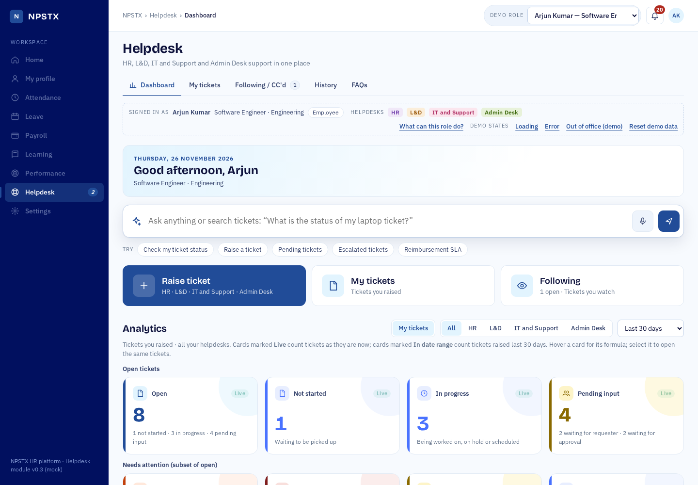
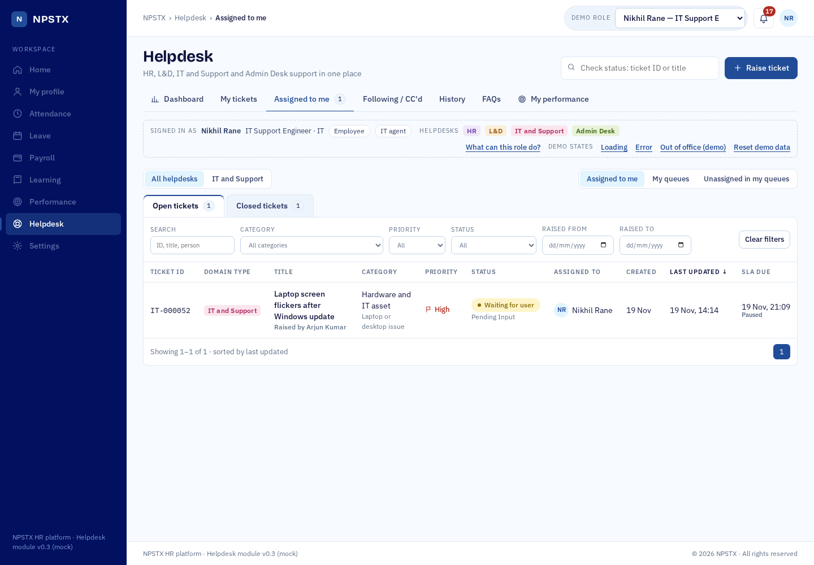
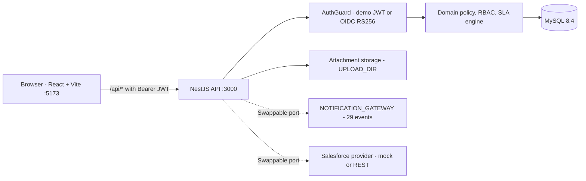

# NPSTX Integrated Helpdesk

[](https://github.com/sprabudh/npstx-helpdesk-app/actions/workflows/ci.yml)


One governed ticketing module for the **NPSTX workspace**. It brings HR, L&D, IT and Support, Admin Desk, and Salesforce requests into a single employee experience with server-side RBAC, SLA escalation, absence cover, approvals, notifications, and admin configuration.

<a href="docs/screenshots/app-dashboard.png">
  
</a>

*Current NPSTX-branded UI, captured at 1440 × 1000. More screens are in [Current UI](#current-ui).*

## Table of Contents

- [At a Glance](#at-a-glance)
- [Objective](#objective)
- [Core Features](#core-features)
- [Current UI](#current-ui)
- [Tech Stack & Architecture](#tech-stack--architecture)
- [Prerequisites](#prerequisites)
- [Quick Start](#quick-start)
- [Environment Configuration](#environment-configuration)
- [Command Reference](#command-reference)
- [Roles & Access](#roles--access)
- [Platform Integration Guide](#platform-integration-guide)
- [Troubleshooting](#troubleshooting)
- [Additional Documentation](#additional-documentation)

## At a Glance

| | |
| --- | --- |
| **What it is** | An internal helpdesk module embedded in the NPSTX platform, not a public customer portal. |
| **Helpdesks** | HR, L&D, IT and Support, Admin Desk, Salesforce. Salesforce is department-gated. |
| **Primary users** | Employees, agents, category leads, approvers, HR/L&D/IT/Admin admins, Helpdesk admins, auditors. |
| **Stack** | React 18 + Vite 5, NestJS 10 + TypeORM, MySQL 8.4, Docker Compose. |
| **Local entry points** | Web `http://localhost:5173` · API `http://localhost:3000` · Swagger `/api/docs`. |
| **Docker entry points** | Web `http://localhost:8080` · API `http://localhost:3000` · MySQL host port from `DB_PORT`. |

## Objective

The NPSTX Helpdesk replaces fragmented email and chat support with one trackable workflow:

- Employees raise, track, follow, and reopen requests across five helpdesks.
- Agents and leads work governed queues with approvals, cover, SLA timers, and escalation.
- Admins configure categories, fields, SLAs, role mapping, and performance rules.
- Integration teams connect Common/RBAC, SSO/OIDC, the Notification Module, and Salesforce through explicit adapter boundaries.

## Core Features

| Audience | What it delivers |
| --- | --- |
| **Employees** | Unified NPSTX shell, role-aware quick actions, multi-department ticket creation, category-specific fields, attachments, Following / CC'd, History, FAQs, and AI-assisted drafting. |
| **Agents & Leads** | Assigned queues, internal notes, reassign and escalate actions, manager approval gates, absence cover, SLA state tracking, reminders, and personal performance reports. |
| **Admin Governance** | Categories, active and approval switches, custom fields, versioned SLAs, escalation ladders, category leads, role mapping, org-wide quantification, and configuration history across all five helpdesks. |
| **Smart / Platform** | Rules-based AI with optional Claude provider, 29 typed notification events through a swappable gateway, OIDC-ready auth, UTC storage with IST display, and mock or REST Salesforce provider. |

<details>
<summary><b>Feature details</b></summary>

### Employee experience

- Raise HR, L&D, IT, Admin Desk, and Salesforce tickets from one raise drawer.
- Follow, CC, mention, reopen, and review closed tickets.
- Search department FAQs and use helpfulness voting.
- Use the built-in rules engine for suggestions, or switch AI to `anthropic` or `none`.

### Workflow engine

- Smart routing to queues or category leads with absence cover reassignment.
- Manager approvals hold the SLA clock until a decision is made.
- SLA scheduler tracks response/resolution targets, at-risk states, breaches, and escalation levels.
- Idempotent reminders cover SLA risk, stuck approvals, waiting-for-employee, and unattended tickets.
- Performance reporting separates direct, inherited, covered, escalated, and breached intervals.

### Integration seams

- `AUTH_MODE=oidc` and `DEMO_MODE=false` switch the app to platform SSO.
- `NOTIFICATION_GATEWAY` isolates notification delivery from ticket logic.
- `SALESFORCE_ADAPTER=mock|rest` switches between the self-contained mock and OAuth REST provider.

</details>

## Current UI

These screenshots are from the running NPSTX-branded app. They replace the older prototype images.

| Dashboard | Assigned to me | Admin console |
| --- | --- | --- |
| [](docs/screenshots/app-dashboard.png) | [](docs/screenshots/app-assigned.png) | [](docs/screenshots/app-admin.png) |

More screens: [My tickets](docs/screenshots/app-tickets.png) · [Ticket detail](docs/screenshots/app-detail.png) · [Raise ticket drawer](docs/screenshots/app-drawer2.png)

## Tech Stack & Architecture

- **Backend:** NestJS 10, TypeScript, TypeORM 0.3, MySQL 8.4 via `mysql2`, Jest, Swagger.
- **Frontend:** React 18, TypeScript, Vite 5, TanStack React Query, Zustand, Vitest, Playwright.
- **Infrastructure:** Docker Compose, Nginx production container, MySQL named volumes.
- **Backend modules:** `admin`, `ai`, `analytics`, `audit`, `auth`, `common`, `database`, `demo`, `domain`, `faq`, `helpdesk-config`, `me`, `notifications`, `performance`, `providers`, `sla`, `tickets`.



Request flow: the web app calls `/api/*`; the API resolves a database-backed `Principal`; domain policy decides views and permissions; MySQL stores tickets, history, notifications, and outbox rows; adapters isolate AI, Salesforce, email, and platform notification delivery.

<details>
<summary><b>Repository structure</b></summary>

```text
npstx-helpdesk-app/
├── backend/
│   ├── src/
│   │   ├── admin/
│   │   ├── ai/
│   │   ├── analytics/
│   │   ├── audit/
│   │   ├── auth/
│   │   ├── common/
│   │   ├── database/
│   │   ├── demo/
│   │   ├── domain/
│   │   ├── faq/
│   │   ├── helpdesk-config/
│   │   ├── me/
│   │   ├── notifications/
│   │   ├── performance/
│   │   ├── providers/
│   │   ├── seed/
│   │   ├── sla/
│   │   └── tickets/
│   ├── test/
│   └── uploads/
├── frontend/
│   ├── src/
│   │   ├── api/
│   │   ├── components/
│   │   ├── pages/
│   │   └── store/
│   └── e2e/
├── db/
│   ├── init/
│   └── seed/
├── docs/
├── docker-compose.yml
├── Makefile
└── .env.example
```

| Path | Use it for |
| --- | --- |
| `backend/src/domain` | Pure policy, SLA, and availability rules. |
| `backend/src/notifications` | Event catalogue, emitter, gateway, and outbox worker. |
| `backend/src/providers` | Native ticket and Salesforce adapters. |
| `frontend/src/components` | NPSTX shell, raise drawer, modals, and shared UI. |
| `db/seed` | Demo configuration and sample tickets. |
| `docs` | SDD, notification spec, and current screenshots. |

</details>

## Prerequisites

| Tool | Required version | Purpose |
| --- | --- | --- |
| Node.js | 20.x LTS or higher; CI uses `20.18.1` | Backend and frontend runtime |
| npm | Bundled with Node.js | Dependency and script runner |
| Docker + Compose v2 | Current stable release | MySQL 8.4 and optional full stack |
| Git | Current stable release | Clone and branch |
| MySQL client | Optional | Direct database inspection |

## Quick Start

### Fast path

Use this if you want the recommended hybrid setup: MySQL in Docker, API and web app locally.

```bash
git clone https://github.com/sprabudh/npstx-helpdesk-app.git
cd npstx-helpdesk-app
cp .env.example .env
```

Set `DB_PASSWORD`, `MYSQL_ROOT_PASSWORD`, and `JWT_SECRET` in `.env`, then run:

```bash
make setup
make dev
```

Open <http://localhost:5173>. Swagger is at <http://localhost:3000/api/docs>.

<details>
<summary><b>Step-by-step local setup</b></summary>

1. Create the environment file.

```bash
cp .env.example .env
```

Set `DB_PASSWORD`, `MYSQL_ROOT_PASSWORD`, and `JWT_SECRET`. Generate a strong secret with `openssl rand -hex 32`.

2. Start MySQL.

```bash
docker compose up -d db
docker compose ps
```

The template maps MySQL to host port `3306`. If that port is occupied, set `DB_PORT=3307` in `.env` before starting the container. The backend container always uses internal MySQL port `3306`.

3. Install dependencies.

```bash
npm --prefix backend install
npm --prefix frontend install
```

4. Migrate and seed.

```bash
npm run db:migrate
npm run db:seed
```

5. Start the two dev servers in separate terminals.

```bash
cd backend
npm run start:dev
```

```bash
cd frontend
npm run dev
```

6. Open the app.

| URL | Purpose |
| --- | --- |
| <http://localhost:5173> | Web app |
| <http://localhost:3000/api/docs> | Swagger API reference |
| <http://localhost:3000/api/health> | Health check |

The app opens as **Arjun Kumar**. Use **Demo role** in the top bar, or open <http://localhost:5173/dashboard?as=u20> for the Helpdesk Admin view.

</details>

### Full Docker Compose

Run all three services in containers:

```bash
docker compose up -d --build
```

| Service | URL |
| --- | --- |
| Web app through Nginx | <http://localhost:8080> |
| Backend API and Swagger | <http://localhost:3000/api/docs> |
| MySQL 8.4 | Host port from `DB_PORT` in `.env` |

The backend waits for MySQL health, runs migrations, seeds only an empty database, and starts the API.

If you return to local dev, free port `3000` first:

```bash
docker compose stop backend frontend
docker compose rm -f backend frontend
```

## Environment Configuration

Copy `.env.example` to `.env`. **Never commit `.env` or share real secrets.** Real environment variables override values from the file.

<details>
<summary><b>Database</b></summary>

| Variable | Template default | Purpose |
| --- | --- | --- |
| `DB_HOST` | `127.0.0.1` | MySQL host for local API runs |
| `DB_PORT` | `3306` | Host-side MySQL port; set `3307` if needed |
| `DB_USER` | `helpdesk` | Application database user |
| `DB_PASSWORD` | `change-me-local-only` | Application database password |
| `DB_NAME` | `helpdesk` | Main database; `helpdesk_e2e` for API tests |
| `MYSQL_ROOT_PASSWORD` | `change-me-root-local-only` | Docker MySQL root password |

</details>

<details>
<summary><b>API, auth, and OIDC</b></summary>

| Variable | Template default | Purpose |
| --- | --- | --- |
| `BACKEND_PORT` | `3000` | NestJS API port |
| `CORS_ORIGIN` | `http://localhost:5173` | Allowed browser origin in local dev |
| `LOG_LEVEL` | `info` | API log verbosity |
| `JWT_SECRET` | placeholder | Token signing secret; production refuses the code default |
| `JWT_TTL_SECONDS` | `1800` | Token lifetime in seconds |
| `AUTH_MODE` | `demo` | `demo` for persona login, `oidc` for production SSO |
| `OIDC_ISSUER` | empty | Expected token issuer |
| `OIDC_AUDIENCE` | empty | Expected token audience |
| `OIDC_CLIENT_ID` | empty | Client identifier metadata |
| `OIDC_USER_CLAIM` | `email` | Claim mapped to a local user |
| `NODE_ENV` | `development` | Set `production` to enable production guards |

</details>

<details>
<summary><b>Runtime, jobs, notifications, and AI</b></summary>

| Variable | Template default | Purpose |
| --- | --- | --- |
| `DEMO_MODE` | `true` | Persona switcher, demo states, reset endpoint |
| `DISPLAY_TIME_ZONE` | `Asia/Kolkata` | Display timezone; canonical data stays UTC |
| `SEED_DIR` | repo `db/seed` | Seed JSON location; Docker overrides this |
| `UPLOAD_DIR` | `./uploads` | Attachment storage directory |
| `SLA_SCHEDULER_ENABLED` | `true` | SLA, escalation, and reminder scheduler |
| `OUTBOX_INTERVAL_MS` | `15000` | Outbox polling interval |
| `EMAIL_ADAPTER` | `console` | Adapter token; local gateway logs recipient domain and subject, not body |
| `AI_PROVIDER` | `rules` | `rules`, `anthropic`, or `none` |
| `ANTHROPIC_API_KEY` | empty | Required for `anthropic` |
| `AI_MODEL` | `claude-sonnet-5-5` | Anthropic model id |
| `ANTHROPIC_BASE_URL` | `https://api.anthropic.com` | Anthropic API base URL |
| `AI_TIMEOUT_MS` | `15000` in template, `20000` in code | Provider timeout |

</details>

<details>
<summary><b>Salesforce, frontend, and E2E</b></summary>

| Variable | Template default | Purpose |
| --- | --- | --- |
| `SALESFORCE_ADAPTER` | `mock` | `mock` for self-contained cases, `rest` for Salesforce OAuth |
| `SALESFORCE_INSTANCE_URL` | empty | Salesforce instance URL |
| `SALESFORCE_CLIENT_ID` | empty | OAuth client id |
| `SALESFORCE_CLIENT_SECRET` | empty | OAuth client secret |
| `SALESFORCE_API_VERSION` | `v61.0` | REST API version |
| `VITE_API_PROXY` | `http://localhost:3000` | Vite dev and preview proxy target |
| `E2E_BASE_URL` | `http://localhost:5173` | Playwright base URL |

</details>

## Command Reference

Run these from the repository root unless noted.

| Task | Command |
| --- | --- |
| Install both apps | `npm run install:all` |
| Apply migrations | `npm run db:migrate` |
| Re-seed demo data | `npm run db:seed` |
| Start API and web with hot reload | `make dev` |
| Backend typecheck | `npm --prefix backend run typecheck` |
| Backend build | `npm --prefix backend run build` |
| Backend unit tests | `npm --prefix backend test` |
| Backend API tests | `DB_NAME=helpdesk_e2e npm --prefix backend run test:e2e` |
| Frontend typecheck | `npm --prefix frontend run typecheck` |
| Frontend build | `npm --prefix frontend run build` |
| Frontend unit tests | `npm --prefix frontend test` |
| Playwright tests | `npm --prefix frontend run e2e` |
| Lint both apps | `npm run lint` |
| Docker stack up / down | `make up` / `make down` |
| Docker stack down and delete volumes | `make clean` |
| Docker MySQL CLI | `docker exec -it npstx-helpdesk-db-1 mysql -u helpdesk -p helpdesk` |

Create the isolated API test database once:

```bash
docker exec -it npstx-helpdesk-db-1 mysql -uroot -p -e "CREATE DATABASE IF NOT EXISTS helpdesk_e2e; GRANT ALL ON helpdesk_e2e.* TO 'helpdesk'@'%'; FLUSH PRIVILEGES;"
```

If Playwright needs a browser:

```bash
npx --prefix frontend playwright install chromium
```

## Roles & Access

Authorization is server-driven. The frontend renders from `GET /api/me` and per-ticket `ticket.me` flags; it does not make security decisions.

| Role | Pages | Can do | Cannot do |
| --- | --- | --- | --- |
| **Employee** | Dashboard, My tickets, Following / CC'd, History, FAQs | Raise and track HR, L&D, IT, and Admin Desk tickets | Assigned to me, My performance, Admin console, Salesforce |
| **Sales / Presales / Solutions employee** | Same employee pages | Everything an employee can do plus Salesforce Helpdesk | Assigned to me, My performance, Admin console |
| **Assignee / Category Lead** | Employee pages plus Assigned to me and My performance | Work assigned queues, notes, reassign, escalate, view personal SLA metrics | Admin console and unmapped confidential categories |
| **Manager** | Employee pages plus pending approvals | Approve or reject configured approval steps | Worker and admin pages unless also assigned |
| **Helpdesk Admin (`HD_ADMIN`)** | Employee pages plus Admin console | Configure all five helpdesks, role mapping, and performance | Confidential ticket content unless explicitly mapped |
| **Auditor (`AUDITOR`)** | Employee pages with read-only visibility | View non-confidential tickets for compliance | Writes, worker queues, and admin console |

Salesforce access is gated by department: only `Sales`, `Presales`, or `Solutions` users receive the `SF` helpdesk.

<details>
<summary><b>Demo personas and /api/me contract</b></summary>

| Persona id | Person | Good for testing |
| --- | --- | --- |
| `u1` | Arjun Kumar, Software Engineer | Default employee view |
| `u6` | Sanjay Menon, Engineering Manager | L&D approvals |
| `u3` | Priya Rao, HR Executive | HR agent work |
| `u8` | Kavya Nair, HR / L&D Admin | Confidential HR and L&D approvals |
| `u4` | Meera Iyer, L&D Head | L&D approval step |
| `u21` | Nikhil Rane, IT Support Engineer | Assigned queue and escalation |
| `u23` | Suresh Pai, IT Head | IT confidential security tickets |
| `u24` | Pooja Shetty, Admin Desk Executive | Facilities, travel, purchase |
| `u25` | Rahul Kapoor, Admin Head | Purchase approvals |
| `u2` | Neha Shah, SFO Sales Rep | Salesforce visibility |
| `u5` | Rohan Das, SFO Case Admin | Salesforce case work |
| `u20` | Asha Kulkarni, Helpdesk Admin | Admin console and configuration |
| `u26` | Ritu Desai, Internal Auditor | Read-only auditor view |

`GET /api/me` returns:

- Identity: `id`, `name`, `dept`, `title`, `location`, `managerId`, `managerName`
- Access: `roles`, `hrCategories`, `roleCategories`, `helpdesks`, `workHelpdesks`
- UI flags: `flags.worker`, `flags.headish`, `flags.approver`, `flags.helpdeskAdmin`, `flags.auditor`
- Rendering data: `views`, `permissions`, `counts`, `now`, `demo`, `outOfOffice`
- Notification count: `counts.notifications`, not top-level `unreadNotifications`

Demo JWTs carry only the user id. Roles, department, and categories are loaded from the database on every request.

</details>

## Platform Integration Guide

### 1. Common App and RBAC / SSO

Production settings:

```text
AUTH_MODE=oidc
DEMO_MODE=false
OIDC_ISSUER=<issuer>
OIDC_AUDIENCE=<audience>
OIDC_CLIENT_ID=<client-id>
OIDC_USER_CLAIM=email
CORS_ORIGIN=<host-app-origin>
JWT_SECRET=<strong-secret>
```

Flow:

```text
Main app SSO
  -> Bearer access token
  -> AuthGuard and oidc.adapter.ts
  -> Principal from users, user_roles, user_hr_categories
  -> domain/policy.ts
  -> GET /api/me
  -> frontend gating
```

Integration points:

- Sync `users`, `user_roles`, and `user_hr_categories`. `dept` drives Salesforce gating; `manager_id` drives approvals.
- Pass the host token with `setToken()` in `frontend/src/api/client.ts`.
- Replace or hide the standalone shell and demo switcher in `frontend/src/components/shell/Shell.tsx`.
- If mounted under a subpath, set the host router basename to `/helpdesk`.

### 2. Notification Module

All 29 events emit through `TicketEventEmitter` in `backend/src/notifications/event-emitter.service.ts` to the `NOTIFICATION_GATEWAY` interface in `backend/src/notifications/gateway.ts`.

| Event group | Count | Examples |
| --- | --- | --- |
| Notifications | 25 | ticket created, status changed, reassigned, approval approved, attachment added, closed |
| Reminders | 4 | SLA at risk, approval stuck, waiting for employee, unattended |

- Confidential text becomes `Update on <ticket key> (confidential)`.
- Confidential payloads contain only `eventType` and `ticketKey`.
- Delivery is idempotent by event, ticket, recipient, and threshold.
- Replace `LocalNotificationGateway` in `backend/src/app.module.ts` with the platform adapter:

```ts
{ provide: NOTIFICATION_GATEWAY, useClass: PlatformNotificationGateway }
```

Notification read endpoints:

| Endpoint | Purpose |
| --- | --- |
| `GET /api/notifications` | List in-app notifications |
| `POST /api/notifications/:id/read` | Mark one read |
| `POST /api/notifications/read-all` | Mark all read |

See [Notification API Specification](docs/Notification_API_Spec.md) for schemas and masking rules.

### 3. Salesforce

Set `SALESFORCE_ADAPTER=rest` and provide:

```text
SALESFORCE_INSTANCE_URL
SALESFORCE_CLIENT_ID
SALESFORCE_CLIENT_SECRET
SALESFORCE_API_VERSION
```

The registry is `backend/src/providers/providers.registry.ts`. The mock and REST adapters are under `backend/src/providers/salesforce/`. The REST adapter uses OAuth client credentials and the standard Case object, but has not been exercised against a live org.

## Troubleshooting

| Symptom | Fix |
| --- | --- |
| `EADDRINUSE` on port `3000` | Stop containerized backend and frontend with `docker compose stop backend frontend && docker compose rm -f backend frontend`, then restart the local API. |
| Database connection refused | Check `docker compose ps`; use `DB_HOST=127.0.0.1` and the host port shown by Compose. |
| DB port `3307` mismatch | The template default is `3306`; the local environment may use `3307`. Match `.env` to `docker compose ps`. |
| Access denied for `helpdesk` | Ensure `.env` credentials match the Docker volume. Use `make clean` only if data loss is acceptable. |
| Pending migrations | Run `npm run db:migrate` before `npm run db:seed`. |
| Seed changes not visible | Re-run `npm run db:seed`; this resets local demo tickets. |
| Timestamps appear 5.5 hours behind | Keep `DISPLAY_TIME_ZONE=Asia/Kolkata`; MySQL stores UTC. |
| Salesforce helpdesk missing | Use a Salesforce persona or sync `dept` as `Sales`, `Presales`, or `Solutions`. |
| AI controls hidden | Use `AI_PROVIDER=rules`, or provide `ANTHROPIC_API_KEY` with `AI_PROVIDER=anthropic`. |
| `401` after a while | Demo tokens expire after 30 minutes; the app signs in again automatically. |
| Playwright browser missing | Run `npx --prefix frontend playwright install chromium`. |

## Additional Documentation

- [Software Design Document](docs/Helpdesk_SDD_v1.0.md)
- [Notification API Specification](docs/Notification_API_Spec.md)
- [Current UI screenshots](docs/screenshots/)
- [Version history](CHANGELOG.md)
- [Swagger API reference](http://localhost:3000/api/docs)

Keep this README, the SDD, and the notification spec in sync when behavior changes.
