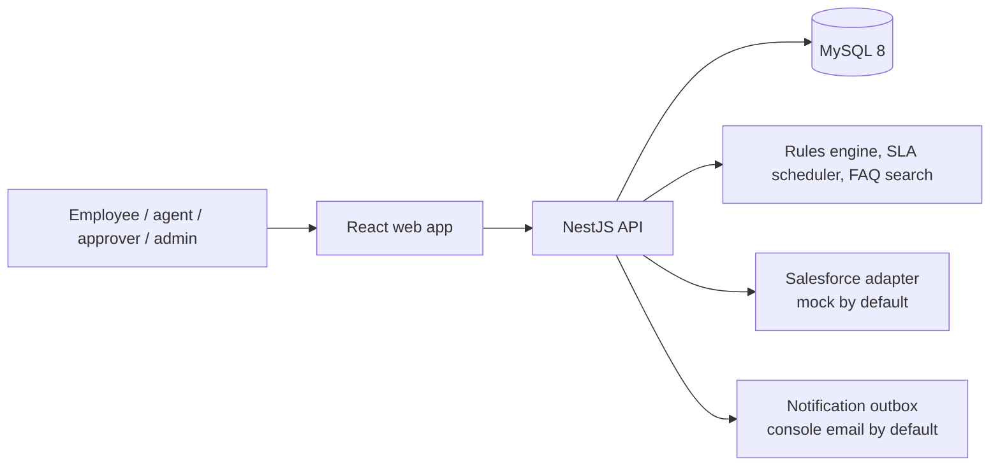

# NPSTX Integrated Helpdesk

One internal helpdesk workspace for **HR**, **L&D**, **IT / Support**, **Admin Desk**, and **Salesforce** users from Sales, Presales, and Solutions.

Employees raise requests, agents work queues, approvers approve decisions, admins configure the system, and auditors get read-only visibility. The app is based on the clickable **NPSTX Helpdesk Prototype v2**; the detailed design is in [the SDD](docs/Helpdesk_SDD_v1.0.md).


## Start here

- **New to the app?** Read [What the helpdesk does](#what-the-helpdesk-does) and [Try a workflow](#try-a-workflow).
- **Want to run it?** Go to [Quick start](#quick-start).
- **Need to check someone's access?** Use [Demo personas](#demo-personas).
- **Looking for a command?** See [Commands](#commands).
- **Something broken?** See [Troubleshooting](#troubleshooting).

## What the helpdesk does

The module replaces scattered email and chat requests with one trackable workflow:

- Raise tickets for HR, L&D, IT, Admin Desk, and Salesforce help.
- Route work to the right team with queues, assignees, status, and priority.
- Use confidential notes where only allowed roles can see them.
- Run approval steps for L&D, IT, purchase, and other configured cases.
- Track SLA targets, pause states, escalation levels, and breaches.
- Search FAQs, get suggested answers, and summarise long tickets.
- Follow tickets, see history, and review personal performance.
- Configure helpdesks, categories, SLAs, canned responses, and users from the admin console.
- Keep Salesforce cases separate from the other helpdesks through role-based access.

This is an **internal employee support app**. It is not a public customer portal. Email is printed to the API log by default, and Salesforce uses a mock adapter until real credentials are supplied.

## Screens

| Screen | What you see | Screenshot |
| --- | --- | --- |
| Dashboard | AI bar, quick actions, counts, approvals, charts | [View](docs/screenshots/app-dashboard.png) |
| Tickets | Open and closed ticket queues with SLA indicators | [View](docs/screenshots/app-tickets.png) |
| Ticket detail | Conversation, notes, approvals, SLA bar, timeline | [View](docs/screenshots/app-detail.png) |
| Raise drawer | Three-step ticket creation with AI assistance | [View](docs/screenshots/app-drawer2.png) |

## Quick start

### Requirements

- Node.js **20+**
- npm
- Docker, or a local MySQL 8 server

### Option A: run everything in Docker

```bash
cp .env.example .env
# set DB_PASSWORD, MYSQL_ROOT_PASSWORD and JWT_SECRET in .env
docker compose up --build
```

Open:

- Web app: <http://localhost:8080>
- API health: <http://localhost:3000/api/health>
- Swagger: <http://localhost:3000/api/docs>

The backend waits for MySQL to become healthy, then runs migrations and seeds an empty database on startup. Uploads and database data live in named Docker volumes.

### Option B: local dev servers

```bash
cp .env.example .env
# set DB_PASSWORD, MYSQL_ROOT_PASSWORD and JWT_SECRET in .env
docker compose up -d db
make install
npm run db:migrate && npm run db:seed
make dev
```

Open:

- Web app: <http://localhost:5173>
- API health: <http://localhost:3000/api/health>
- Swagger: <http://localhost:3000/api/docs>

`make setup` combines the env copy, database start, dependency install, migration, and seed into one command.

The app opens on the Dashboard as **Arjun Kumar**. Use the **Demo role** control in the top bar to switch people, or open a deep link such as <http://localhost:5173/dashboard?as=u20>.

## Try a workflow

### 1. Raise and follow a ticket

1. Sign in as **Arjun Kumar** (`u1`).
2. Click **Raise ticket** on the Dashboard or in the sidebar.
3. Choose a helpdesk, category, subject, and description.
4. Submit the ticket and open it from **My tickets**.
5. Click **Follow** to keep it in the Following list.

### 2. Work an agent queue

1. Switch to **Nikhil Rane** (`u21`) for IT work or **Priya Rao** (`u3`) for HR work.
2. Open **Assigned to me** or the relevant ticket queue.
3. Reply, add an internal note, change status, reassign, or escalate.
4. Watch the SLA bar, timeline, and approval banners update.

### 3. Approve a request

1. Switch to **Sanjay Menon** (`u6`) to approve a pending L&D request.
2. Switch to **Rahul Kapoor** (`u25`) to approve purchase requests.
3. Open **Dashboard** and use the approval card, or open the ticket directly.

### 4. Check role-based visibility

1. Compare **Arjun Kumar** (`u1`) with **Asha Kulkarni** (`u20`).
2. Asha sees the admin console and nearly every non-Salesforce ticket.
3. Compare **Neha Shah** (`u2`) or **Rohan Das** (`u5`) with Arjun to see the Salesforce helpdesk appear only for Salesforce roles.
4. Switch to **Ritu Desai** (`u26`) for read-only auditor access.

### 5. Reset the demo

Use **Reset demo data** in the role strip when `DEMO_MODE=true`. It asks for confirmation because it deletes ticket changes and reloads the sample data.

## Demo personas

| ID | Person | Use this persona to try |
| --- | --- | --- |
| `u1` | Arjun Kumar, Software Engineer | Default view; raise tickets, reply to `IT-000052`, reopen `HR-000098` |
| `u6` | Sanjay Menon, Engineering Manager | Approve `LND-000048` from the Dashboard |
| `u3` | Priya Rao, HR Executive | Work HR tickets, internal notes, canned responses |
| `u8` | Kavya Nair, HR / L&D Admin | Read-only HR, including confidential tickets; L&D approvals |
| `u4` | Meera Iyer, L&D Head | L&D approval step and all L&D tickets |
| `u21` | Nikhil Rane, IT Support Engineer | Assigned-to-me queue, status changes, escalate `IT-000050` |
| `u23` | Suresh Pai, IT Head | All IT tickets, including confidential security tickets |
| `u24` | Pooja Shetty, Admin Desk Executive | Facilities, travel, and purchase tickets |
| `u25` | Rahul Kapoor, Admin Head | Purchase approvals |
| `u2` | Neha Shah, SFO Sales Rep | Salesforce helpdesk visibility |
| `u5` | Rohan Das, SFO Case Admin | Salesforce case queue |
| `u20` | Asha Kulkarni, Helpdesk Admin | Admin console, configuration menus, every ticket except Salesforce |
| `u26` | Ritu Desai, Internal Auditor | Read-only access without confidential tickets |

## Pages and routes

| Route | Page | Main users |
| --- | --- | --- |
| `/dashboard` | Dashboard with quick actions, approvals, counts, and charts | Everyone |
| `/tickets` | My tickets | Requesters and agents |
| `/assigned` | Assigned to me | Agents |
| `/following` | Tickets the user follows | Everyone |
| `/history` | Recently viewed tickets | Everyone |
| `/faqs` | FAQ list and editor | Everyone; editors depending on role |
| `/admin` | Admin console | Helpdesk admins |
| `/performance` | Personal performance summary | Agents and managers |
| `/ticket/:key` | Ticket detail | Anyone allowed to see that ticket |

Unknown routes redirect to the Dashboard.

## How it is built



| Folder | Contents |
| --- | --- |
| `backend/` | NestJS API, TypeORM entities, migrations, seed CLI, policies, SLA jobs, adapters, tests |
| `frontend/` | React + Vite web app, pages, shell, drawer, modals, hooks, tests |
| `db/` | MySQL init script and JSON seed data extracted from the prototype |
| `docs/` | SDD, notification API spec, and reference screenshots |

The backend is the source of truth. Roles and permissions are loaded from the database on every request, and the UI uses `GET /api/me` to decide what to show. Never rely on hidden frontend controls for security.

## Key concepts

### Tickets

Every ticket has a readable key such as `HR-000098`, a helpdesk, category, requester, assignee, status, priority, SLA state, followers, and a timeline. Confidential tickets and confidential notes are visible only to allowed roles.

### Helpdesks and queues

HR, L&D, IT / Support, Admin Desk, and Salesforce each have their own configuration and visibility rules. Salesforce data is isolated from the other helpdesks.

### SLA

SLA clocks use configured business rules and escalation levels. Paused, awaiting-approval, at-risk, overdue, and breached states are shown in ticket lists and detail pages. The scheduler can run automatically or be triggered once from the admin API.

### Approvals

Approval steps are attached to the ticket flow. The API decides whether a person can approve; the Dashboard only shows actions that are allowed for that persona.

### AI assist

`AI_PROVIDER=rules` is the default and runs entirely in the API. `anthropic` calls Claude when an API key is configured. `none` disables AI and hides AI controls in the UI.

### Notifications

Notifications are written to an outbox. With `EMAIL_ADAPTER=console`, messages are printed in the API log instead of being sent. See [Notification API Spec](docs/Notification_API_Spec.md).

### Salesforce adapter

`SALESFORCE_ADAPTER=mock` keeps the app self-contained. Set it to `rest` and provide `SALESFORCE_*` values only when connecting to a real Salesforce org.

## Configuration

All settings come from `.env`; see [`.env.example`](.env.example). Secrets are never committed.

| Setting | Default | Notes |
| --- | --- | --- |
| `DB_HOST`, `DB_PORT`, `DB_USER`, `DB_PASSWORD`, `DB_NAME` | `127.0.0.1`, `3306`, `helpdesk`, local password, `helpdesk` | MySQL connection |
| `MYSQL_ROOT_PASSWORD` | local password | Needed by the Docker database |
| `BACKEND_PORT` | `3000` | API port |
| `CORS_ORIGIN` | `http://localhost:5173` | Set to `http://localhost:8080` for the full Docker stack |
| `JWT_SECRET` | placeholder | Must be a long random value in real deployments |
| `JWT_TTL_SECONDS` | `1800` | Demo tokens expire after 30 minutes; the app signs in again automatically |
| `AUTH_MODE` | `demo` | `demo` enables persona login; `oidc` verifies RS256 tokens |
| `OIDC_ISSUER`, `OIDC_AUDIENCE`, `OIDC_CLIENT_ID`, `OIDC_USER_CLAIM` | empty / `email` | Used when `AUTH_MODE=oidc` |
| `DEMO_MODE` | `true` | Persona switcher, demo states, and reset endpoint |
| `DISPLAY_TIME_ZONE` | `Asia/Kolkata` | Timezone used for displayed helpdesk times |
| `SLA_SCHEDULER_ENABLED` | `true` | Automatic SLA processing; disable to keep sample SLA states static |
| `OUTBOX_INTERVAL_MS` | `15000` | Notification outbox polling interval |
| `EMAIL_ADAPTER` | `console` | Logs emails instead of sending them |
| `UPLOAD_DIR` | `./uploads` | Attachment storage directory |
| `AI_PROVIDER` | `rules` | `rules`, `anthropic`, or `none` |
| `ANTHROPIC_API_KEY`, `AI_MODEL`, `ANTHROPIC_BASE_URL`, `AI_TIMEOUT_MS` | empty, `claude-sonnet-5-5`, Anthropic URL, `15000` | Used when `AI_PROVIDER=anthropic` |
| `SALESFORCE_ADAPTER` | `mock` | `mock` or `rest` |
| `SALESFORCE_INSTANCE_URL`, `SALESFORCE_CLIENT_ID`, `SALESFORCE_CLIENT_SECRET`, `SALESFORCE_API_VERSION` | empty / `v61.0` | Used when `SALESFORCE_ADAPTER=rest` |

For a non-demo deployment, set `DEMO_MODE=false`, use `AUTH_MODE=oidc`, replace `JWT_SECRET`, and point `CORS_ORIGIN` at the real web origin.

## Commands

| Command | What it does |
| --- | --- |
| `make setup` | Ensure `.env` exists, start MySQL, install dependencies, migrate, and seed |
| `make install` | `npm ci` in `backend/` and `frontend/` |
| `make dev` | Start the API and Vite dev server with watch mode |
| `make api` | Start only the API |
| `make web` | Start only the web app |
| `make migrate` | Run database migrations |
| `make seed` | Reload sample data |
| `make reset` | Reload sample data; same as `make seed`; destructive |
| `make test` | Run backend and frontend unit tests |
| `make test-api` | Run API tests against the configured MySQL database |
| `make e2e` | Run Playwright browser tests; start `make dev` first |
| `make lint` | Lint backend and frontend source |
| `make up` | Start the Docker stack |
| `make down` | Stop the Docker stack |
| `make clean` | Stop the stack and delete Docker volumes; destructive |
| `npm run db:migrate && npm run db:seed` | Root-level migration and seed shortcuts |
| `npm --prefix frontend run build` | Typecheck and build the production web bundle |
| `curl -fsS http://localhost:3000/api/health` | Check API health |

API tests use `DB_NAME` from `.env` and reseed it. Set `DB_NAME=helpdesk_e2e` for those runs if you want to protect your development data.

## Data and persistence

- Sample data is loaded only when needed; normal ticket changes persist across refresh and restart.
- MySQL data is stored in the `dbdata` Docker volume. Attachments are stored in the `uploads` volume or `UPLOAD_DIR`.
- `make seed` and the in-app **Reset demo data** action delete ticket changes and reload sample data.
- `make clean` deletes the Docker database and upload volumes.
- The SLA scheduler changes SLA fields on purpose. Disable it if you need the seed data to stay visually identical to the prototype.

## API docs

Swagger UI is available at <http://localhost:3000/api/docs>. Useful starting points:

| Endpoint | Purpose |
| --- | --- |
| `GET /api/health` | Health check |
| `POST /api/auth/demo-login` | Sign in as a demo persona |
| `GET /api/me` | Current user, roles, and visible helpdesks |
| `GET /api/tickets` | Ticket queries filtered by access rules |
| `GET /api/approvals/pending` | Approval cards for the current user |
| `POST /api/admin/sla/run` | Run one SLA pass |
| `POST /api/demo/reset` | Reload demo data when `DEMO_MODE=true` |

Use Swagger for the complete request and response schema.

## Tests and quality

| Check | Command |
| --- | --- |
| Backend unit tests | `npm --prefix backend test` |
| Frontend unit tests | `npm --prefix frontend test` |
| API tests with MySQL | `npm run test:api` |
| Browser tests | `npm run test:e2e` |
| Lint | `npm run lint` |
| Backend typecheck | `npm --prefix backend run typecheck` |
| Frontend typecheck | `npm --prefix frontend run typecheck` |

Run these before opening a pull request. API and Playwright tests need the app and database running. If Playwright reports a missing browser, install it with:

```bash
npx --prefix frontend playwright install chromium
```

## Troubleshooting

| Problem | Fix |
| --- | --- |
| `ECONNREFUSED 127.0.0.1:3306` | Start MySQL with `docker compose up -d db` and wait until `docker compose ps` shows it healthy |
| Access denied for user | Make sure `.env` passwords match the Docker volume. Use `make clean` only if you accept losing local data |
| Pending migrations found | Run `npm run db:migrate` before `npm run db:seed` |
| Port 3306, 3000, 5173, or 8080 in use | Change `DB_PORT`, `BACKEND_PORT`, `CORS_ORIGIN`, or the frontend proxy, then restart |
| No Docker | Install MySQL 8 and create the database and user, then migrate and seed |
| Numbers differ from the prototype | Run `make seed`; check whether `SLA_SCHEDULER_ENABLED` is changing the data |
| AI features are hidden | `AI_PROVIDER=none`, or `anthropic` without `ANTHROPIC_API_KEY`; use `rules` for offline AI |
| Salesforce helpdesk is missing | Switch to a Salesforce persona such as `u2` or `u5` |
| `401` after a while | Demo tokens expire after 30 minutes; the app signs the persona in again automatically |
| Playwright cannot find Chromium | Run `npx --prefix frontend playwright install chromium` |

To use MySQL without Docker:

```sql
CREATE DATABASE helpdesk;
CREATE USER 'helpdesk'@'%' IDENTIFIED BY 'choose-a-password';
GRANT ALL ON helpdesk.* TO 'helpdesk'@'%';
FLUSH PRIVILEGES;
```

Then set the same values in `.env`, run migrations, and seed.

## Documentation

- [Software design document](docs/Helpdesk_SDD_v1.0.md)
- [Notification API spec](docs/Notification_API_Spec.md)
- [Reference screenshots](docs/screenshots/)
- [Changelog](CHANGELOG.md)

When changing behavior, update the SDD as well so the documentation and implementation stay aligned.

## Contributing

1. Create a branch from the default branch.
2. Keep `.env` local and never commit secrets.
3. Make the smallest change that solves the problem.
4. Run lint, typechecks, and the relevant tests.
5. Update the SDD or this README when behavior or setup changes.
