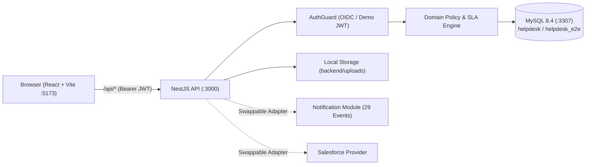

# NPSTX Integrated Helpdesk

An enterprise multi-department Helpdesk module built for the **NPSTX workspace**, unifying internal support across **HR**, **L&D**, **IT and Support**, **Admin Desk**, and **Salesforce** into a single platform.

---

## Table of Contents
- [Objective](#objective)
- [Key Features](#key-features)
- [Tech Stack & Architecture](#tech-stack--architecture)
- [Repository Structure](#repository-structure)
- [Prerequisites](#prerequisites)
- [Quick Start (Local Development)](#quick-start-local-development)
- [Running Fully in Docker](#running-fully-in-docker)
- [Environment Configuration](#environment-configuration)
- [Command Reference & Testing](#command-reference--testing)
- [Roles & Access Matrix (RBAC)](#roles--access-matrix-rbac)
- [Platform Integration Guide](#platform-integration-guide)
- [Troubleshooting](#troubleshooting)

---

## Objective

The NPSTX Helpdesk replaces fragmented email/chat support requests with a single, governed ticketing platform embedded inside the NPSTX workspace. It is designed to:

- Give every employee one consistent place to raise, track, and follow support tickets across departments.
- Automate routing, manager approvals, absence cover, and SLA escalations so tickets never stall unattended.
- Enforce strict server-side RBAC, confidential ticket masking (e.g., HR Grievances, IT Security), and department-scoped Salesforce access.
- Integrate cleanly with NPSTX Common SSO/OIDC, HRMS/Leave/Attendance feeds, and the central Notification Module via swappable adapters.

---

## Key Features

### Employee Experience
- **Unified Dashboard:** AI-powered search/drafting bar, role-aware 3-button quick actions, and live personal analytics.
- **Multi-Department Ticketing:** Raise tickets for HR, L&D, IT and Support, Admin Desk, and (for Sales/Presales/Solutions) Salesforce with dynamic category-specific custom fields and file attachments.
- **Following / CC'd & History:** Track tickets where you are followed, CC'd, or mentioned; view closed ticket history with CSV export and reopen support.
- **Self-Service FAQs:** Searchable department FAQs with helpfulness voting.

### Agent, Lead & Workflow Engine
- **Smart Routing & Absence Cover:** Auto-routes tickets to category leads or queues and dynamically reassigns cover when an agent is on approved leave or absent past the 11:00 IST cut-off.
- **Manager Approval Gates:** Configurable per-category manager approvals that hold SLA timers until approved.
- **Automated SLA & Escalation Ladder:** Background scheduler tracks response/resolution targets, warns at risk, and auto-escalates at configured ladder thresholds (50% / 75% / breach) while logging immutable assignment and escalation history.
- **Assignee Performance:** Fair, interval-based performance reporting separating direct vs. inherited tickets across mutually exclusive SLA outcomes (no misleading single % score).

### Admin Governance Console
- Manage categories, active/manager-approval switches, custom form fields, immutable versioned SLAs, escalation ladders, category leads, multi-department role mapping, org-wide performance quantification, and a complete configuration audit log across all 5 helpdesks (including Salesforce).

---

## Tech Stack & Architecture

- **Backend:** NestJS (TypeScript), TypeORM, MySQL 8.4 (`mysql2`), Jest (Unit & E2E)
- **Frontend:** React, TypeScript, Vite, TanStack React Query, Vitest, Playwright
- **Infrastructure:** Docker Compose (MySQL 8.4 on host port `3307`, Nginx production container)



---

## Repository Structure

```text
npstx-helpdesk-app/
├── backend/
│   ├── src/
│   │   ├── admin/             # Admin Console APIs (categories, fields, SLA, roles, audit)
│   │   ├── ai/                # Rules engine, guardrails & LLM provider wrappers
│   │   ├── analytics/         # Dashboard metrics & live/range quantification
│   │   ├── audit/             # Immutable configuration & access audit logger
│   │   ├── auth/              # AuthGuard, JWT/OIDC JWKS verification adapter
│   │   ├── common/            # Env config, IST clock, decorators, filters, JSON logger
│   │   ├── database/          # TypeORM DataSource, 26 entities, SQL migrations
│   │   ├── demo/              # Demo-only endpoints (disabled when DEMO_MODE=false)
│   │   ├── domain/            # Pure business rules (policy.ts, sla.ts, availability.ts) + specs
│   │   ├── faq/               # FAQ listing, voting & editing
│   │   ├── helpdesk-config/   # Cached config, queues & lookups
│   │   ├── me/                # /api/me contract & notification read routes
│   │   ├── notifications/     # Event catalogue (29 events), emitter & NotificationGateway
│   │   ├── performance/       # Direct vs. inherited assignee SLA interval engine
│   │   ├── providers/         # Pluggable Salesforce provider adapter
│   │   ├── seed/              # Seed CLI & reset service
│   │   ├── sla/               # Automated SLA breach & escalation scheduler
│   │   └── tickets/           # Ticket creation, workflow actions, cover, queries & loader
│   ├── test/                  # Jest E2E test suite (runs against helpdesk_e2e)
│   └── uploads/               # Runtime ticket attachment storage
├── frontend/
│   ├── src/
│   │   ├── api/               # HTTP client, types & React Query hooks
│   │   ├── components/        # Shell, RaiseDrawer, Modals, PerfReport & shared UI
│   │   ├── pages/             # Dashboard, Tickets, TicketDetail, History, FAQs, Admin, Perf
│   │   └── store/             # Client UI state scoped per signed-in user
│   └── e2e/                   # Playwright browser E2E tests
├── db/
│   ├── init/                  # MySQL UTF-8 bootstrap SQL
│   └── seed/                  # helpdesk-config.json & seed-data.json
├── docs/                      # SDD & integration specifications
├── docker-compose.yml         # MySQL, Backend & Frontend containers
└── .env.example               # Safe environment variable template
```

---

## Prerequisites

- **Node.js:** v20.x LTS or higher (with `npm`)
- **Docker & Docker Compose:** v24+ (used for MySQL 8.4)
- **Git**

---

## Quick Start (Local Development)

The recommended workflow runs **only MySQL in Docker** while running the NestJS backend and Vite frontend locally for instant hot-reload.

### 1. Clone the repository
```bash
git clone <YOUR_GITHUB_REPO_URL>
cd npstx-helpdesk-app
```

### 2. Create your local environment file
```bash
cp .env.example .env
```
Open `.env` and fill in local values for `DB_PASSWORD`, `MYSQL_ROOT_PASSWORD`, and `JWT_SECRET` (you can generate a strong secret with `openssl rand -hex 32`).

### 3. Start the MySQL database container
```bash
docker compose up -d db
```
Verify the container is healthy on port `3307`:
```bash
docker compose ps
```

### 4. Install dependencies
```bash
npm --prefix backend install
npm --prefix frontend install
```

### 5. Run database migrations & seed demo data
```bash
npm run db:migrate
npm run db:seed
```

### 6. Start Backend & Frontend (2 separate terminals)

**Terminal 1 — NestJS Backend (`http://localhost:3000`):**
```bash
cd backend
npm run start:dev
```

**Terminal 2 — Vite Frontend (`http://localhost:5173`):**
```bash
cd frontend
npm run dev
```

Open **[http://localhost:5173](http://localhost:5173)** in your browser. Swagger API docs are available at `http://localhost:3000/api/docs` (if enabled).

---

## Running Fully in Docker

To build and run all three services (`db`, `backend`, `frontend`) inside containers:

```bash
docker compose up -d --build
```

- **Frontend (Nginx):** `http://localhost:8080`
- **Backend API:** `http://localhost:3000`
- **MySQL 8.4:** `127.0.0.1:3307`

> **Switching back to local dev?** Stop the Docker backend and frontend containers first so port `3000` is free:
> ```bash
> docker compose stop backend frontend
> docker compose rm -f backend frontend
> ```

---

## Environment Configuration

Copy `.env.example` to `.env`. **Never commit `.env` or share real secrets.**

| Group | Variable | Description | Default / Example |
| :--- | :--- | :--- | :--- |
| **Database** | `DB_HOST`, `DB_PORT`, `DB_NAME` | MySQL connection settings | `127.0.0.1`, `3307`, `helpdesk` |
| **Database** | `DB_USER`, `DB_PASSWORD`, `MYSQL_ROOT_PASSWORD` | DB credentials *(mask before sharing)* | `helpdesk`, `<secret>` |
| **API & Auth** | `BACKEND_PORT`, `CORS_ORIGIN` | API port & allowed frontend origin | `3000`, `http://localhost:5173` |
| **API & Auth** | `AUTH_MODE` | `demo` (local switcher) or `oidc` (production SSO) | `demo` |
| **API & Auth** | `JWT_SECRET`, `JWT_TTL_SECONDS` | Signing key *(keep secret)* & TTL | `<64-char-hex>`, `1800` |
| **OIDC** | `OIDC_ISSUER`, `OIDC_AUDIENCE`, `OIDC_CLIENT_ID`, `OIDC_USER_CLAIM` | Production IdP verification settings | `email` |
| **Runtime** | `DEMO_MODE`, `DISPLAY_TIME_ZONE` | Toggle demo UI/routes; display timezone | `true`, `Asia/Kolkata` |
| **Jobs** | `SLA_SCHEDULER_ENABLED`, `OUTBOX_INTERVAL_MS`, `UPLOAD_DIR` | Scheduler, outbox worker & attachment folder | `true`, `15000`, `./uploads` |
| **AI** | `AI_PROVIDER`, `ANTHROPIC_API_KEY`, `AI_MODEL` | `rules` (default offline), `anthropic`, or `none` | `rules` |
| **Salesforce** | `SALESFORCE_ADAPTER`, `SALESFORCE_INSTANCE_URL`, `SALESFORCE_CLIENT_ID`, `SALESFORCE_CLIENT_SECRET` | `mock` (default) or `rest` | `mock` |

---

## Command Reference & Testing

Run these commands from the repository root (`npstx-helpdesk-app/`):

| Task | Command |
| :--- | :--- |
| Apply DB migrations | `npm run db:migrate` |
| Reset & re-seed demo data | `npm run db:seed` |
| Backend TypeScript typecheck | `npm --prefix backend run typecheck` |
| Backend unit tests (`policy`, `sla`, `availability`, `rules-engine`) | `npm --prefix backend test` |
| Backend E2E tests (runs against isolated `helpdesk_e2e` DB) | `npm --prefix backend run test:e2e` |
| Frontend production build & typecheck | `npm --prefix frontend run build` |
| Frontend unit tests | `npm --prefix frontend test` |
| Connect to Docker MySQL CLI | `docker exec -it npstx-helpdesk-db-1 mysql -u helpdesk -p helpdesk` |

---

## Roles & Access Matrix (RBAC)

Authorization is strictly **server-driven**. The frontend never hardcodes role checks—it renders navigation and actions exclusively from `GET /api/me` (`flags`, `views`, `helpdesks`, `permissions`) and per-ticket `ticket.me` flags.

| Role / Persona | Allowed Pages | Key Capabilities | Restricted |
| :--- | :--- | :--- | :--- |
| **Employee** *(Non-Sales Dept)* | Dashboard, My tickets, Following / CC'd, History, FAQs | Raise/track HR, L&D, IT, Admin Desk tickets; Dashboard 3rd button = **Following** | Assigned to me, My performance, Admin console, Salesforce |
| **Sales / Presales / Solutions Employee** | Same 5 Employee pages | All Employee capabilities **+ Salesforce Helpdesk** access | Assigned to me, My performance, Admin console |
| **Assignee / Category Lead** | Employee pages + **Assigned to me** + **My performance** | Work queue/assigned tickets, internal notes, reassign/escalate, personal SLA metrics; Dashboard 3rd button = **Assigned to me** | Admin console, other departments' queues, unmapped confidential categories |
| **Helpdesk Admin (`HD_ADMIN`)** | Employee pages + **Admin console** | Configure Categories, Form fields, SLA & escalation, Role mapping, and Assignee performance across all 5 helpdesks | Confidential ticket contents unless explicitly mapped as custodian |
| **Manager** *(via `managerId`)* | Employee pages + Pending Approvals | Approve/reject manager-approval tickets for direct reports | Worker & Admin pages (unless also assigned those roles) |
| **Auditor (`AUDITOR`)** | Employee pages (read-only org visibility) | View non-confidential tickets for compliance | All write/work actions & Admin console |

---

## Platform Integration Guide

When embedding Helpdesk inside the main **NPSTX sidebar**, disable demo mode and wire the three integration seams:

### 1. Common App & RBAC / SSO (OIDC)
- Set `AUTH_MODE=oidc`, `DEMO_MODE=false`, `OIDC_ISSUER`, `OIDC_AUDIENCE`, `OIDC_CLIENT_ID`, `OIDC_USER_CLAIM`, and `CORS_ORIGIN` in production env.
- **Auth Flow:** `Main App SSO Login → Bearer Access Token → AuthGuard (oidc.adapter.ts) → Principal from DB (auth.service.ts) → domain/policy.ts → /api/me → Frontend Gating`.
- **User Provisioning:** Sync NPSTX users into `users` (`dept` drives Salesforce gating; `manager_id` drives Manager Approvals), `user_roles`, and `user_hr_categories`.
- **Frontend Embedding:** Pass the host access token via `setToken()` in `frontend/src/api/client.ts`, replace/bypass the standalone sidebar and demo switcher in `frontend/src/components/shell/Shell.tsx`, and set `BrowserRouter basename="/helpdesk"` if mounted under a subpath.

### 2. Notification Module Integration
- All 29 Helpdesk events (25 notifications + 4 SLA/approval reminders) emit through `TicketEventEmitter` (`backend/src/notifications/event-emitter.service.ts`) to the `NOTIFICATION_GATEWAY` interface (`backend/src/notifications/gateway.ts`).
- Replace `LocalNotificationGateway` in `backend/src/app.module.ts` with the platform Notification Module HTTP/queue adapter—no ticket logic changes required.
- Refer to `docs/helpdesk-notification-integration.md` (if present in `docs/`) for full event schemas and confidential masking rules.

### 3. Salesforce Integration
- Toggle `SALESFORCE_ADAPTER=rest` and provide Salesforce OAuth credentials to switch from the in-process mock adapter (`backend/src/providers/salesforce/`).

---

## Troubleshooting

- **`Error: listen EADDRINUSE: address already in use 0.0.0.0:3000`**
  The Docker `backend` container is occupying port `3000`. Run `docker compose stop backend frontend && docker compose rm -f backend frontend`, then restart `npm run start:dev` inside `backend/`.
- **Database connection refused on port `3307`**
  Confirm Docker MySQL is running (`docker compose ps`) and `.env` has `DB_HOST=127.0.0.1` and `DB_PORT=3307`.
- **Changes to `db/seed/helpdesk-config.json` not appearing locally**
  Re-run `npm run db:seed` from the repo root (note: this resets local demo tickets).
- **Timestamps look 5.5 hours behind local time**
  MySQL stores canonical UTC (`timezone: 'Z'`); ensure `DISPLAY_TIME_ZONE=Asia/Kolkata` is set in `.env` and restart the backend.

---

## Additional Documentation
- **Software Design Document:** `docs/Helpdesk_SDD_v1.0.md`
- **Version History:** `CHANGELOG.md`